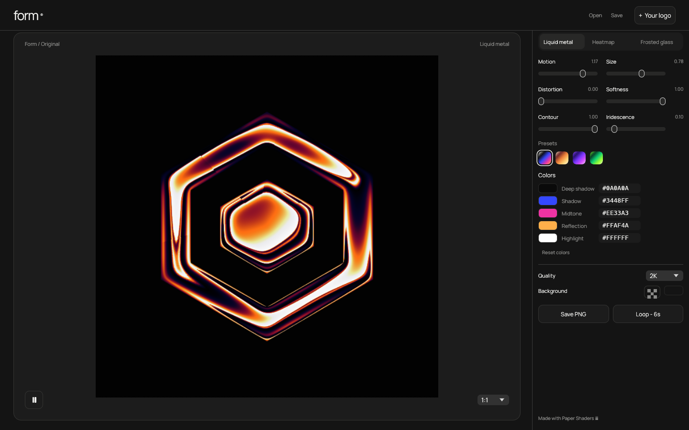
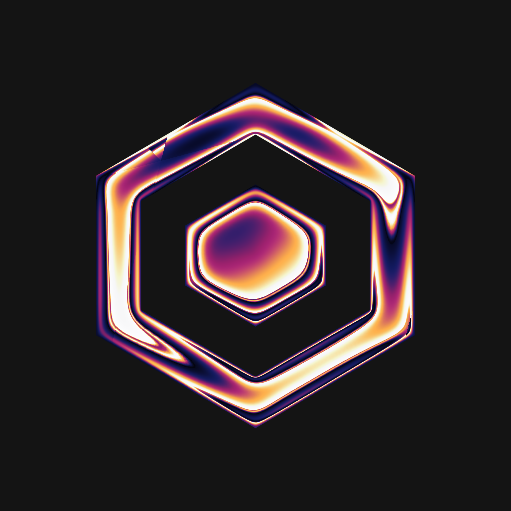
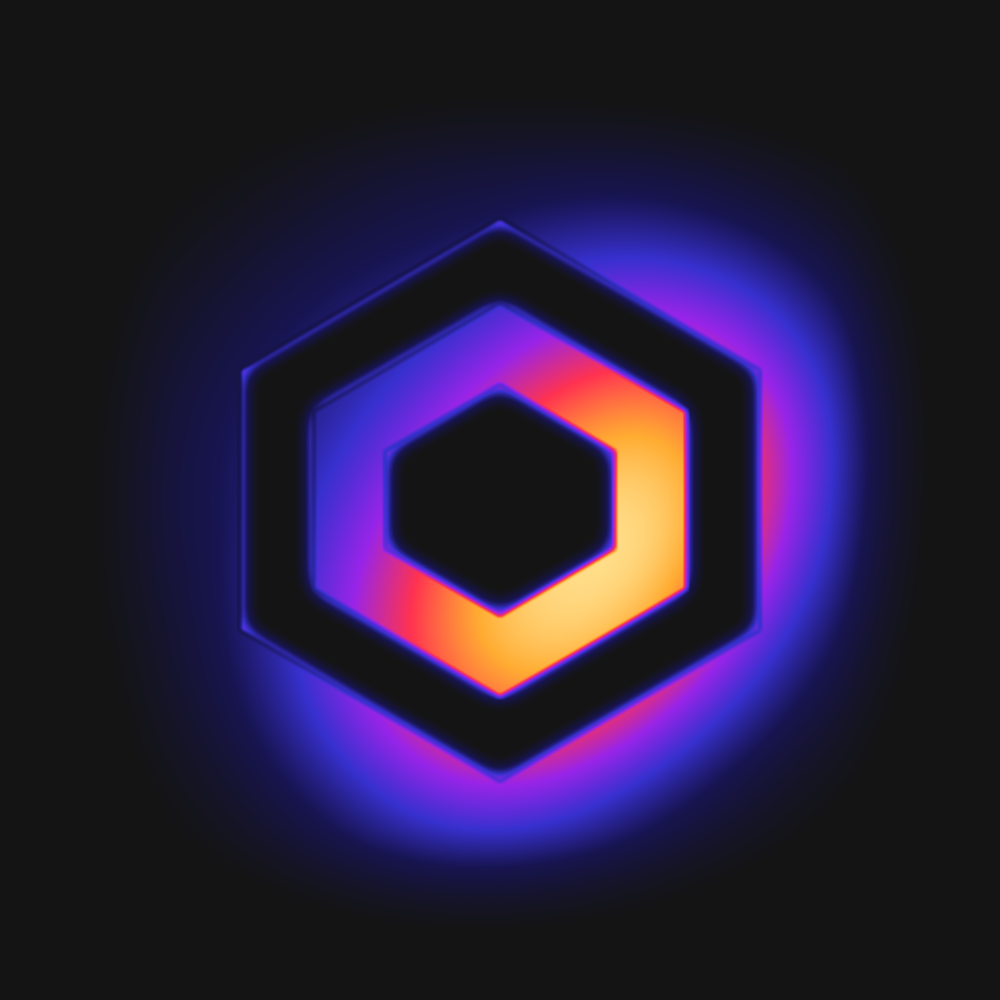
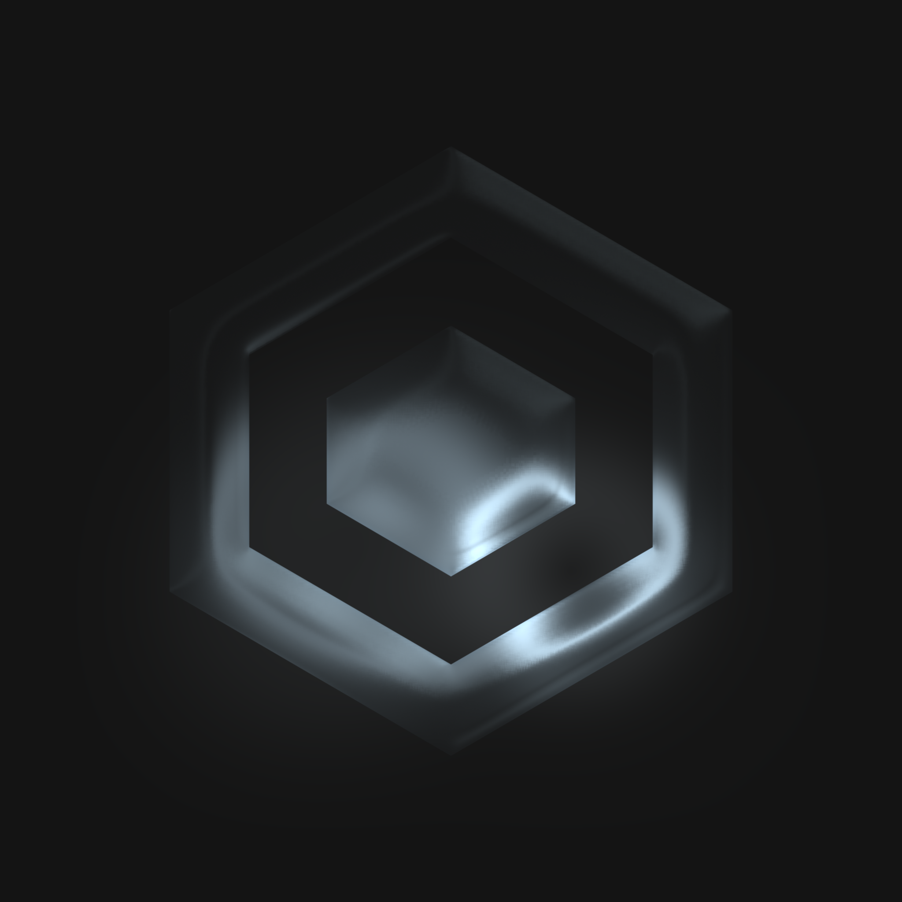

# Form

Turn a logo into animated **liquid metal**, a **heatmap** or **frosted glass**,
then export a still PNG or a seamless six-second loop. Native, offline, no
accounts, no uploads, no API keys.

A Rust rewrite of the [Form](https://github.com/youraipulse/Form) browser editor:
same three materials, same parameters, same presets — rendered with `wgpu`
instead of WebGL.



| Liquid metal | Heatmap | Frosted glass |
|---|---|---|
|  |  |  |

## Install

Download the package for your platform from
[Releases](https://github.com/bimoalfarrabi/form-rs/releases):

| Platform | Files |
|---|---|
| Windows | `form-…-setup.exe` (NSIS), `.msi`, portable `.zip` |
| macOS | `.dmg` (Apple silicon and Intel, unsigned) |
| Linux | `.deb`, `.AppImage`, portable `.tar.gz` |

The macOS builds are ad-hoc signed but not notarised. macOS will report an
unidentified developer the first time; allow it under **System Settings →
Privacy & Security → Open Anyway**, or clear the quarantine flag:

```bash
xattr -dr com.apple.quarantine /Applications/Form.app
```

## Build from source

Requires Rust 1.88 or newer and a GPU with Vulkan, Metal, DX12 or OpenGL.

```bash
cargo run -p form-app --release
```

Linux also needs the windowing and EGL headers:

```bash
sudo apt install libxkbcommon-dev libwayland-dev libx11-xcb-dev \
  libxcb-render0-dev libxcb-shape0-dev libxcb-xfixes0-dev \
  libegl1-mesa-dev libvulkan-dev
```

## Use

1. **＋ Your logo** (or drop a file anywhere) — SVG, PNG or WebP with a
   transparent background.
2. Pick a material: **Liquid metal**, **Heatmap**, **Frosted glass**.
3. Adjust the sliders, choose a **preset**, or edit the material's **colors**.
4. Set **Quality** (2K/4K), **Background** and the aspect ratio under the
   preview.
5. **Save PNG** for a still, **Loop · 6s** for a 180-frame seamless WebM.

Loop export pipes raw frames to `ffmpeg` with `libvpx-vp9`. Form looks for it,
in order:

1. the path you picked last time (stored in the settings file),
2. `FORM_FFMPEG`,
3. `ffmpeg` / `ffmpeg.exe` next to the app, in `ffmpeg/`, or in
   `Contents/Resources` inside the macOS bundle (drop a build there to make a
   self-contained copy),
4. `ffmpeg` on `PATH`.

If none is found, clicking **Loop · 6s** opens a file picker so you can point at
an `ffmpeg` binary once; the choice is remembered. To see what Form resolves
without opening the editor:

```bash
form --check-ffmpeg
```

Defaults: heatmap, Motion 1.50, Size 0.65, Inner glow 0.41, Outer glow 0.49,
Contour 0.46, Direction 306°.

## How it works

```
app/                 eframe/egui editor: state, preview, dark panel UI
crates/form-render/  wgpu pipeline, CPU preprocessing, WGSL shaders
  src/wgsl/          metal.wgsl, heat.wgsl, glass.wgsl
  src/preprocess/    Poisson/SOR field for metal, integral-image blurs for heat
```

The three fragment shaders are hand-ported from the Paper Shaders GLSL the web
app uses. Two details had to be reproduced rather than translated:

- the heat shader relies on `smoothstep` with reversed edges, which ANGLE
  evaluates to `0` (GLSL leaves it undefined);
- the shaders composite **premultiplied sRGB** bytes into a plain `Rgba8Unorm`
  target, so the renderer must not use an sRGB format or an sRGB view for
  export.

`docs/PARITY.md` records the pixel-level comparison against the browser, the
measurement method and the remaining differences.

## Development

```bash
cargo test --workspace          # includes naga validation of every WGSL module
cargo clippy --workspace --all-targets -- -D warnings
cargo run -p form-app -- --screenshot /tmp/ui.png   # one frame, then exit
```

Parity fixtures are not distributed here. `FORM_FIXTURES=/path/to/maps` points
the golden-render binaries at the upstream maps; see `docs/PARITY.md`.

## License

Dual-licensed under [MIT](LICENSE-MIT) or [Apache-2.0](LICENSE-APACHE), at your
option. Third-party notices are in [NOTICE](NOTICE): the shaders derive from
[Paper Shaders](https://github.com/paper-design/shaders) (Apache-2.0), and the
bundled Manrope font is under the SIL Open Font License.
